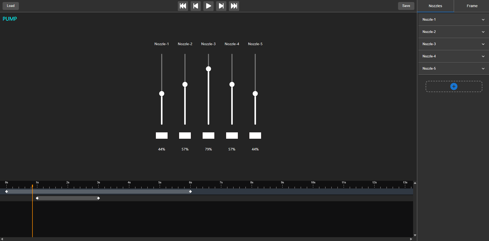
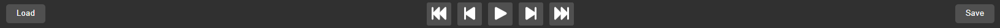
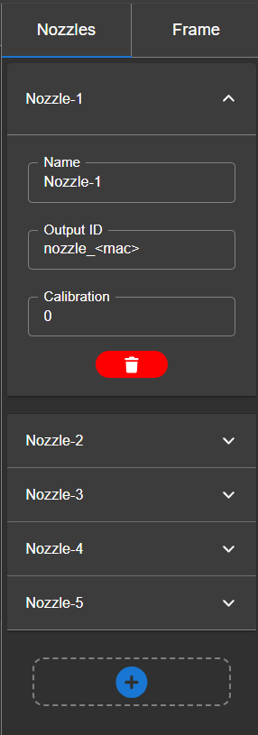
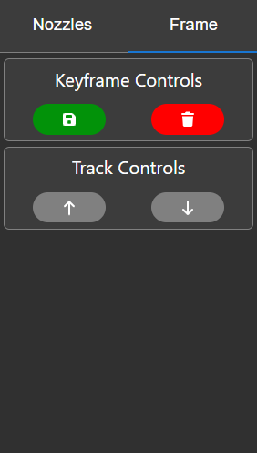
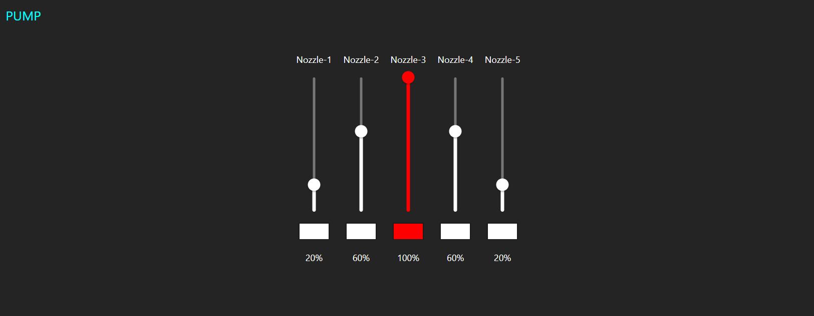
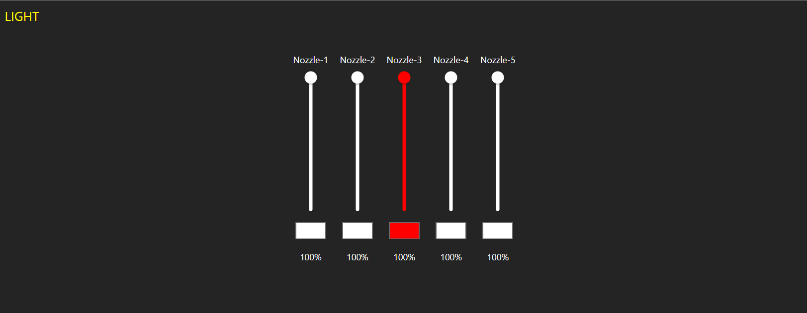
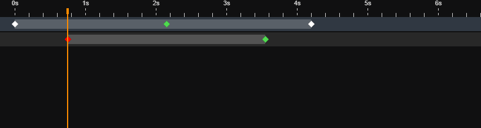

# Fountain Show Creator

Over the winter of 2025, my family and I, started building water nozzles with LED rings to create dynamic water and light shows for our garden. The firmware for the nozzles were developed using HomeAssistant + ESPHome. But in HomeAssistant (HA), the only way to control the nozzles (out of the box) was using the HA mobile app. However there were limitations of using the app: such as only being able to send commands to nozzles one at a time, making it no where near practical for creating dynamic shows.

So, I created this application, to create and visualise the nozzles, by being able to input both pump % and light RGB at a given moment in time. Nozzle values are chosen by the user and are saved as a keyframe in the show timeline. The timeline will then linearly interpolate between the keyframes, allowing for users to visualise how the show transitions into the next keyframe, whilst also permitting timeline scrubbing.

The application will then export the show as a YAML file, which was then loaded into a small python script running on my HA server to actually carry out the dynamic show.

## Languages and Frameworks

  - HTML
  - CSS / [styled-components](https://www.npmjs.com/package/styled-components)
  - Typescript
  - [React.js](https://react.dev/)
  - [animation-timeline-js](https://github.com/ievgennaida/animation-timeline-control)
  - [js-yaml](https://www.npmjs.com/package/js-yaml)

# How To Use

Below shows the full application and I will discuss each component in more detail.



## Header



The header gives controls for timeline playback and scrubbing.

The timeline controls available are:
 - (`|<<`) move the timeline to 0s
 - (`|<`) move the timeline back by 500ms
 - (`▶` / `⏸`) play / pause the timeline `[spacebar]`
 - (`>|`) move the timeline forward by 500ms
 - (`>>|`) move the timeline to the last keyframe in any of the tracks
 - Additional fine movements are available by using the arrow keys to move forward `[->]` 50ms and backward `[<-]` 50ms.


The header also allows users to save and load their show into YAML. 

An example YAML show is shown below.
```yaml
config:
  pulse_rate: 50        # sample rate at which the show runs at
  Nozzle-1:             # nozzle name
    name: nozzle_1      # output identifier
    calibration: 0      # any additional linear calibrations to apply
  Nozzle-2:
    ...

keyframes:
  - keyframe:
      id: 0               # unique keyframe ID
      transition: true    # do we have to transition into this keyframe
      values:             # a list of all changed values in this keyframe
        Nozzle-1:
          pump: 100       # new pump value
          light:          # new argb value
            - 100
            - 255
            - 255
            - 255
        Nozzle-2:
          ...
  - keyframe:
      id: 1
      ...

timeline:                 # list the timeline of keyframes to execute
  - keyframe:
      id: 0               # the ID of which keyframe should we execute
      time: 0             # the time (in ms) when this keyframe should execute
      track: 0            # which track is this keyframe from (0 = pump, 1 = light)
  - keyframe:
      id: 1
      ...
```

## SideBar

There are two tabs on the side bar listed as 'Nozzle' and 'Frame'. 

The 'Nozzle' tab deals with creating / deleting nozzles, renaming nozzles, adding output identifiers and linear calibrations.



The 'Frame' tab deals with common keyframe commands (such as saving a keyframe and deleting a keyframe) and track selections.



## Workspace

The workspace is where you will visually adjust nozzle heights and nozzle colors for the active keyframe. 
On the 'PUMP' track, the vertical sliders will represent the nozzle heights from 0%-100%, additionally the color input boxes will be disabled. 
On the 'LIGHT' track, the vertical sliders will represent the brightness (opacity) value of the nozzle, and the color input boxes will be enabled.

A view for the 'PUMP' track is shown as:



And a view for the 'LIGHT' track is shown as:



Workspace controls:
- Left clicking on a nozzle will select that nozzle. And `[CTRL]` + left click allows for multiple nozzles to select
- Right clicking on a nozzle will open a menu which consists of:
  - Copy pump
  - Copy light
  - Copy both
  - Paste
- `[a]` selects all the nozzles

## Timeline

The timeline is divided into two tracks, the pump track and light track. Users can create keyframes which control pump values, and they can create keyframes which control light values independently. This means there can exist a show where the nozzles slowly move from 0%-100% whilst the lights constantly flicker or change color (for example).



- The orange bar (playhead) indicates where we currently are in the show (measured in seconds).
- If a track is dark blue, then that track is currently selected.
- Keyframe view:
  - White keyframes indicate that the animator will transition linearly to that keyframe.
  - Green keyframes mean that the animator will not transition to that keyframe, and instead, instantly display that keyframe once the playhead hits the keyframe.
  - Red keyframes show that a keyframe (or keyframes) are selected.

I've implemented a few keyboard shortcuts to make keyframe editing easier
- `[k]` creates a new keyframe at the current time, on the selected track.
- `[t]` toggles the transition type between linear and static on the selected keyframe.
- `[CTRL]` + `[c]` copies the currently selected keyframes.
- `[CTRL]` + `[v]` pastes the copied keyframes (starting from the playhead).
- `[backspace]` or `[Del]` deletes the selected keyframe(s.)